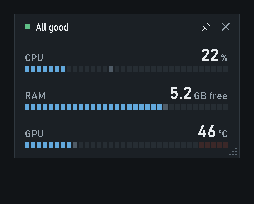
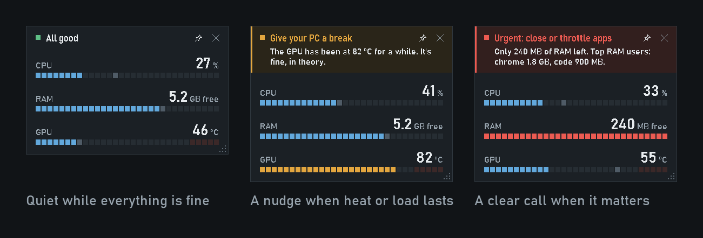
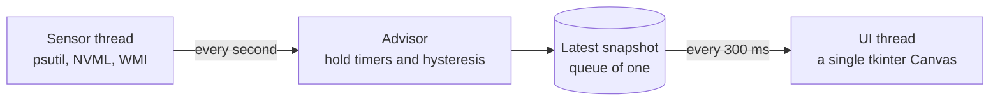

<div align="center">



# Telltale

**A tiny always-on-top hardware gauge for Windows that stays quiet until your PC needs you.**

[](https://github.com/barraco002/telltale/actions/workflows/ci.yml)
[](https://github.com/barraco002/telltale/releases/latest)
[](https://www.python.org/)
[](#quick-start)
[](requirements.txt)
[](LICENSE)

[**Download for Windows**](https://github.com/barraco002/telltale/releases/latest) &nbsp;|&nbsp; [Quick start](#quick-start) &nbsp;|&nbsp; [How it decides](#how-it-decides) &nbsp;|&nbsp; [Contributing](CONTRIBUTING.md)

</div>

---

Most hardware monitors are dashboards: dozens of numbers you have to read and interpret. **Telltale is a warning light.** Like the telltales on a car's dashboard, it shows three honest meters, says *All good*, and stays out of your way until heat, load or memory actually call for you.

## Why Telltale

- **Quiet by default.** No pings because a browser is using RAM, no "recovered" notifications, no flicker around a threshold.
- **It speaks plainly.** Not just "CPU 96%" but *"The CPU has been at 95% for over a minute. It's fine, in theory."*
- **Only real data.** Sensors your hardware can't report are hidden, never faked as 0%. An old GT 710 doesn't report utilization, so Telltale shows its temperature instead.
- **Hands off your apps.** When it's urgent, Telltale names the two heaviest processes. You decide what to close; it never kills anything.
- **Featherweight.** One Python file, tkinter plus psutil. No Electron, no Qt, no web view, no network access. The process list is only read while an urgent alert is on screen.

## How it decides

Two levels, each held for a while before it speaks, and each with hysteresis so it never flickers.

| Level | When | What you see |
|---|---|---|
| **Give your PC a break** (amber) | Heat ≥ 80 °C for 30 s, or CPU ≥ 90% for 60 s | What is causing it, and *"It's fine, in theory."* |
| **Urgent: close or throttle apps** (red) | Heat ≥ 90 °C for 5 s, or ≤ 300 MB of free RAM for 5 s | The reason and the two processes using the most RAM or CPU |

The advice tints the top band and the meter that triggered it, the panel grows just enough to fit the message, and everything goes back to *All good* the moment the condition clears. A temperature reading turns amber from 80 °C and red from 85 °C straight away; until a rule kicks in, the headline simply says *Running hot*.

<p align="center">
  
</p>

## Quick start

### Download (no Python needed)

Grab **Telltale.exe** from the [latest release](https://github.com/barraco002/telltale/releases/latest) and run it. Each release also ships a `.sha256` checksum. The build isn't code-signed, so Windows SmartScreen may ask you to confirm the first time (*More info → Run anyway*).

### With pipx

```powershell
pipx install "telltale-gauge[all] @ git+https://github.com/barraco002/telltale.git"
telltale
```

`[all]` adds NVIDIA GPU and CPU temperature support. `telltale` opens the panel; `telltale-cli --self-test` prints sensor diagnostics.

### From source

```powershell
git clone https://github.com/barraco002/telltale.git
cd telltale
py -3 -m venv .venv
.\.venv\Scripts\Activate.ps1
pip install -r requirements.txt
python telltale.py
```

Want it on your Desktop and Start menu? `powershell -ExecutionPolicy Bypass -File .\install-shortcuts.ps1`

## Using it

| To | Do this |
|---|---|
| Move it | Drag anywhere on the panel |
| Resize it | Drag the corner grip: the whole panel scales and the height follows the content |
| Step the size | Ctrl+− and Ctrl+Plus |
| Reset the size | Double-click the grip, or Ctrl+0 |
| Keep it on top | Pin button, or Ctrl+T |
| Close it | ✕, or Esc |

Scale and position are remembered in `%APPDATA%\Telltale\settings.json`.

## What it reads

| Meter | Source | If it can't be read |
|---|---|---|
| CPU usage | psutil | always available |
| RAM | psutil (free and total) | always available |
| GPU usage and temperature | NVIDIA NVML via nvidia-ml-py | the GPU row is hidden |
| CPU temperature | LibreHardwareMonitor / OpenHardwareMonitor over WMI, then ACPI, then psutil | not shown |

**Want CPU temperature?** Windows rarely exposes it directly. Run [LibreHardwareMonitor](https://github.com/LibreHardwareMonitor/LibreHardwareMonitor) as administrator, then check with `python telltale.py --self-test`: it should report `source: LibreHardwareMonitor`.

## Make it yours

Every threshold is a plain constant at the top of [`telltale.py`](telltale.py):

```python
REST_HEAT_C, REST_HEAT_OFF_C, REST_HEAT_HOLD = 80.0, 76.0, 30.0        # °C, exit °C, seconds
REST_LOAD_PCT, REST_LOAD_OFF_PCT, REST_LOAD_HOLD = 90.0, 80.0, 60.0    # %, exit %, seconds
URGENT_HEAT_C, URGENT_HEAT_OFF_C, URGENT_HEAT_HOLD = 90.0, 86.0, 5.0   # °C, exit °C, seconds
URGENT_RAM_MB, URGENT_RAM_OFF_MB, URGENT_RAM_HOLD = 300.0, 360.0, 5.0  # MB, exit MB, seconds
```

## How it works



- Sensors are read on a daemon thread, so the panel never freezes, even when WMI is slow.
- The **Advisor** is plain Python with no Tk: that is why the alert rules have their own test suite.
- The whole panel is drawn on one Canvas in design units, so it scales exactly at any size and DPI.
- The type is **Bahnschrift**, the DIN typeface that ships with Windows, used for road signs and instruments. The headline uses its narrow cut so it fits on one line.

## Development

```powershell
powershell -ExecutionPolicy Bypass -File .\verify.ps1   # compile, self-test, alert rules, GUI smoke test
python tools\make_media.py                              # regenerate the images in this README
python tools\check_layout.py                            # check the screenshot's alignment
powershell -ExecutionPolicy Bypass -File .\tools\check_release.ps1   # check the published release and its checksum
```

CI runs the same checks on Windows with Python 3.10, 3.12 and 3.13.

## Roadmap

- [ ] AMD and Intel GPUs through LibreHardwareMonitor
- [ ] Free disk space meter
- [ ] Tray icon and start with Windows
- [ ] Light theme
- [ ] Spanish UI (Telltale started life in Spanish)

Ideas and votes are welcome in [Discussions](https://github.com/barraco002/telltale/discussions).

## Contributing

Bug reports, sensor support for more hardware and translations are all welcome. Read [CONTRIBUTING.md](CONTRIBUTING.md) first: the short version is *stay quiet unless the PC needs action, show only real data, and add no heavy dependencies*.

## License

[MIT](LICENSE) © barraco002

Built on [psutil](https://github.com/giampaolo/psutil), [nvidia-ml-py](https://pypi.org/project/nvidia-ml-py/) and [LibreHardwareMonitor](https://github.com/LibreHardwareMonitor/LibreHardwareMonitor).
